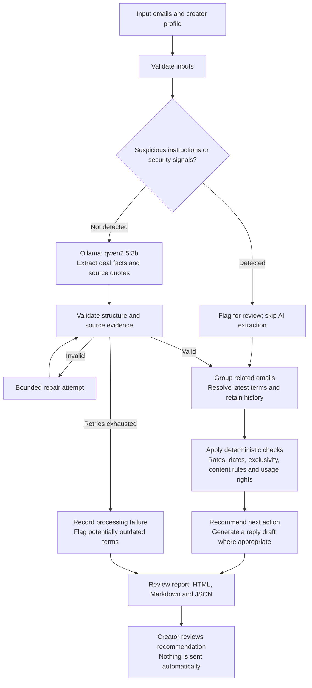

# Brand Deal Inbox Assistant

A review queue for creators: understand the offer, see its latest terms, identify risks, and draft the next reply. Nothing is sent automatically.

**Runs immediately with Python 3.10+ and no third-party Python dependencies.**

Three explicit modes:

- **`rules` (default):** a free, deterministic offline baseline. No model download, API key, internet or model credits required. This is not an LLM.
- **`ollama`:** semantic extraction with a locally installed model, followed by the same validation, grouping and policy engine. No paid API. Actual local AI quality and latency must be measured on the chosen model.
- **`api` (experimental):** hosted OpenAI-compatible chat completions. Groq is the documented starting option; selected email subject/body are sent to that external service. Live smoke attempts to Groq and Gemini did not produce a successfully processed email; do not treat hosted mode as verified.

**Verified on this Windows machine:** Python 3.13.5, 62 automated tests passed, offline regression 15/15 categories, 45/45 key fields, exact grouping and 36/36 deal checks. Live Ollama `qwen2.5:3b`: 15/15 emails processed; the same selected fixture checks passed. This is a development-fixture regression, **not** a blind or independent estimate of model quality. See [live outputs](examples/live/) and [live evaluation](examples/live-evaluation/).

## Quick start from the extracted folder or a fresh clone

Open PowerShell in the repository folder (the folder containing this README). These source-folder commands were run successfully on Windows with Python 3.13.5; Python 3.10 or newer is required.

```powershell
python --version
python -m brand_inbox analyze
python -m brand_inbox evaluate --strict
python -m unittest discover -s tests -v
```

No `pip install` is required. If `python` is not on PATH, use `py -3` in place of `python`. The Python package has no runtime dependencies.

Then open **`artifacts/run/report.html`** in your browser. It is a read-only, standalone report with a compact attention summary, grouped review queue, expandable source evidence and run details; it works directly from `file://` and is not a hosted application. The same run writes:

| File | Contents |
|---|---|
| `artifacts/run/analysis.json` | Every email, original extracted facts, groups, latest terms, risks, drafts, evidence and run metadata |
| `artifacts/run/summary.md` | Plain-language creator action queue |
| `artifacts/run/report.html` | Read-only visual review queue; no scripts or external assets |
| `artifacts/evaluation/evaluation.json` | Machine-readable checks, counts and mismatches |
| `artifacts/evaluation/evaluation.md` | Human-readable evaluation and confusion matrix |

Windows convenience command: `run_demo.bat`. macOS/Linux: `sh run_demo.sh`.

Pre-generated offline results and the measured live inference results are in `examples/`. Opening those does not run analysis again.

## Run with a real local AI model

1. Install [Ollama](https://ollama.com/download). Follow its [Windows instructions](https://docs.ollama.com/windows).
2. Pull a model and ensure Ollama is running:

```powershell
ollama pull qwen2.5:3b
ollama list
```

The [official qwen2.5:3b model page](https://ollama.com/library/qwen2.5:3b) lists this model. It was used for the Windows live run documented below. Model weights are not bundled. If Ollama is not already running, start `ollama serve` in another terminal. No paid API was used.

3. Run the actual model path and evaluate its results separately:

```powershell
python -m brand_inbox analyze --provider ollama --model qwen2.5:3b --timeout 180 --out artifacts/live
python -m brand_inbox evaluate --actual artifacts/live/analysis.json --out artifacts/live-evaluation
```

The command-line model name must match an installed model. Alternatively set `$env:JEEVIT_MODEL="qwen2.5:3b"`. `.env.example` documents variables; `.env` files are **not** loaded automatically.

The adapter follows Ollama's [Chat API](https://docs.ollama.com/api/chat) and [structured output schema](https://docs.ollama.com/capabilities/structured-outputs). It sends only the email subject/body and analysis date, not the complete creator profile. No model tools are enabled. The independently detected security cases are handled by rules before model inference.

If a model is missing, malformed output persists after repair, or the local server fails, the record has an explicit processing error and no fabricated category. Validation errors identify the field and safe reason, and a bounded repair request includes that diagnostic without echoing model/email text. Connection failure skips remaining ordinary model calls; safety-only cases can still be processed. A failed reply/update is flagged on any matching campaign so previous terms are not shown as current. The command exits nonzero. There is **no silent switch to the offline baseline**.

For opt-in local diagnosis, add `--debug-model-response`. It prints Ollama responses to stderr and may include quoted email content; responses are not logged by default.

## Optional hosted API mode

The initial adapter is verified against Groq's current OpenAI-compatible [Chat Completions documentation](https://console.groq.com/docs/openai), which documents `https://api.groq.com/openai/v1` and API-key authentication. The [Groq model catalog](https://console.groq.com/docs/models) currently lists `openai/gpt-oss-20b`; its [model page](https://console.groq.com/docs/model/openai/gpt-oss-20b) publishes per-token prices. Groq's [Structured Outputs documentation](https://console.groq.com/docs/structured-outputs) explicitly lists that model as supporting strict JSON Schema output. The adapter sends strict schema output for that verified model; other model IDs use the API's documented JSON-object mode plus the same local validation. It does not silently downgrade if the strict request is rejected.

Groq documents organization-level, model-specific request/token limits in its [rate-limit documentation](https://console.groq.com/docs/rate-limits); exact limits depend on the account and model. The public model page lists metered prices. I could not verify from public official documentation that this model's access is guaranteed free for every account. **Do not enable billing for this assignment.** Confirm in your own console that the chosen model is usable without billing before proceeding. The application cannot determine account quota or billing eligibility and never estimates or reports hosted API cost as `$0`; hosted cost is recorded as unknown. Do not run a live request unless you have checked that the account/model access will not incur charges.

Create a key in the [Groq API Keys page](https://console.groq.com/keys). In PowerShell, set it for the current terminal without displaying it or writing it into the repository:

```powershell
$secureKey = Read-Host "Groq API key (input hidden)" -AsSecureString
$env:JEEVIT_API_KEY = [System.Net.NetworkCredential]::new("", $secureKey).Password
```

`.env` is **not** automatically loaded. The hosted configuration variables are `JEEVIT_API_BASE_URL` (defaults to Groq), `JEEVIT_API_KEY` (required), and `JEEVIT_API_MODEL` (defaults to `openai/gpt-oss-20b`). `--model` overrides the configured model. Never put the key in command-line arguments, source code, logs, output files, or chat.

After privately setting the key, first prepare a two-email smoke input (N-01 is an ordinary offer; N-02 is its follow-up) using only the supplied assignment data, then run just those two emails:

```powershell
python -c "import json; from pathlib import Path; emails=json.loads(Path('data/new_inbox.json').read_text(encoding='utf-8')); Path('artifacts').mkdir(exist_ok=True); Path('artifacts/api-smoke-inbox.json').write_text(json.dumps(emails[:2], ensure_ascii=False, indent=2), encoding='utf-8')"
python -m brand_inbox analyze --provider api --inbox artifacts/api-smoke-inbox.json --out artifacts/api-smoke
```

Only after inspecting that output, continue with the four-email inbox, then the supplied 15-email inbox and its separate evaluation if the confirmed free quota permits and without enabling billing:

```powershell
python -m brand_inbox analyze --provider api --inbox data/new_inbox.json --out artifacts/api-new-inbox
python -m brand_inbox analyze --provider api --out artifacts/api
python -m brand_inbox evaluate --actual artifacts/api/analysis.json --out artifacts/api-evaluation
```

Use `--inbox` to select an input file, `--profile` for the creator profile, and `--timeout` to bound each request. The adapter requires HTTPS, refuses cross-origin redirects, sends only the analysis date and the email subject/body, and enables no tools, browsing, or sending. It keeps the email untrusted and validates parsed JSON and exact source quotes locally. Authentication/configuration failures are not retried; rate limits honor bounded `Retry-After`, retries are capped, and a fatal provider error prevents further model requests. Progress contains email IDs/status/duration only, never email content or responses. A different provider with a non-compatible API format requires a separate adapter; compatibility with one OpenAI-like endpoint is not a guarantee for every service.

The model will receive selected email text outside your computer. Do not use hosted mode for sensitive inbox data unless you have reviewed the provider's data-handling terms and have permission to share it. The program does not log API keys or hosted responses by default. For opt-in local diagnosis, `--debug-model-response` prints model response text to stderr; it may contain quoted email content. API-key text is redacted. Use `--api-attempts 1` with a one-email input to limit diagnostic calls.

Exit codes: `0` successful command; `1` partial processing or failed strict evaluation; `2` invalid input/configuration. Evaluation without `--strict` writes the report even when accuracy is imperfect.

## Design: where AI helps, where code must be right

The diagram follows the verified Ollama `qwen2.5:3b` run. The same validation, grouping and deterministic policy stages are used with the offline rules extractor and experimental hosted API.



**The model** interprets language and proposes structured facts: advertiser, deliverables, cash/gifting, dates, rights and campaign references. This helps with paraphrases and multilingual input that a grammar misses. It never selects final actions or writes free-form replies.

**Plain code** validates outputs, performs Decimal monetary arithmetic, applies the profile's fixed exchange rate, compares rate-card prices, evaluates dates/policies, merges explicit terms, and generates controlled reply templates. Evidence quotes and source email IDs make a decision inspectable. Evidence is not proof that a model understood the sentence correctly.

**Grouping** requires corroboration. Follow-ups from the same sender and normalized subject can link; an agency needs matching brand, scope, dates and an explicit reference. Same brand alone is insufficient. Later explicit terms replace earlier values; missing fields inherit. Ambiguity remains separate with a flag. Original per-email extraction is preserved, while final categories reflect the resolved conversation's current policy status.

**Example:** Dew Lab's E-01 offers INR 120,000. E-02 revises it to INR 100,000. E-11 is an agency follow-up for the same campaign. The tool keeps one group, uses INR 100,000, and retains the change history. Two reels plus three stories cost INR 110,000 at the creator's base rates, so the recommendation is negotiate. No value is treated as booked revenue.

`docs/ARCHITECTURE.md` has module responsibilities, a sequence diagram, trust boundaries and grouping details. `docs/INTERVIEW.md` provides a short walkthrough and questions to prepare for.

## Decision rules

- Suspicious assistant instructions, pay-to-join schemes and phishing indicators: report; no positive reply.
- Active exclusivity or prohibited content: decline, regardless of budget.
- Newsletters: ignore.
- Incomplete proposals or past deadlines: request details or revised dates.
- Below-rate cash, gifting-only work, extended rights or whitelisting: negotiate.
- Unresolved essential terms prevent unconditional acceptance. A sufficiently complete suitable proposal can receive an accept recommendation, still subject to human agreement review.

A below-rate or expired concrete offer remains `deal_offer`; `not_a_fit` is reserved for creator-policy conflicts. Gifting is not automatically prohibited. Generic Gmail senders and tax-detail requests are not automatically scams.

The analysis uses **2026-11-12 from the profile**, never the computer clock. USD conversion uses **1 USD = INR 84 from the profile**. Dates without a year assume the profile year; a delivery-relative deadline stays unresolved when delivery is unknown.

## Evaluation and mistakes

`eval/expected_answers.json` was authored from the assignment before the pipeline, with explicit category rationale. Runtime modules never load it. All 15 original emails have category and key-field expectations; grouping, latest cash, selected risks, actions and no-reply safety cases are tested separately.

| Run | Processed | Categories | Key fields | Grouping | Deal checks |
|---|---:|---:|---:|---|---:|
| Supplied fixture / offline rules | 15/15 | 15/15 | 45/45 | Exact | 36/36 |
| Synthetic stress / offline rules | 8/8 | 8/8 | 12/12 | Exact | Not specified |
| Live Ollama `qwen2.5:3b` on Windows | 15/15 | 15/15 | 45/45 | Exact | 36/36 |

Both supplied inbox expectations and synthetic stress examples were available during development. These scores are **regression checks on known examples**, not blind evaluation or a claim of 100% real-world accuracy. Counts represent selected checks, not all possible extraction fields or errors.

The live row is the **hybrid pipeline**, not a model-only classification score: categories, risk decisions, arithmetic and actions are deterministic code. The unfiltered model extraction candidates matched 36/40 selected field checks (90%) across the 12 emails sent for model extraction; three safety-prefiltered emails bypassed the model. After exact-source checks and deterministic corroboration, the selected pipeline fields scored 45/45. The 15 Ollama HTTP calls include retries; the model reported 6,358 input and 4,922 output tokens. Review raw candidates, corrections and per-field provenance in `examples/live/analysis.json`.

Hosted mode has had real smoke attempts but **has not passed live verification**. The preserved [Gemini smoke output](examples/api-experimental/gemini-smoke/analysis.json) records 0/2 processed after six model calls (four retries), 20.69 seconds, and 3,186 input / 1,791 output tokens reported by the provider. Both messages failed local extraction validation; no hosted categories, grouping, or recommendations were produced. The earlier Groq smoke attempt also processed 0/2 and stopped after a 403 permission error. These failures are not successful hosted inference results. Hosted cost and billing were not queried and remain unknown. Mocked HTTP tests are only adapter tests, not model verification. Keep API outputs separate from rules and Ollama results.

The first stress run exposed these offline parser limits; general number-word and IG abbreviation support was then added and the refreshed stress set passed:

| Case | Initial result | Fix |
|---|---|---|
| S-07: “fifty thousand rupees” | Amount unknown | Parse supported English number words deterministically |
| S-08: “1 IG reel” | Deliverables empty | Recognize `IG` as Instagram shorthand |

The live adapter initially rejected malformed model evidence/dates and had an unsupported inferred deliverable on a Dew Lab follow-up. It now normalizes common month-name dates, checks source quotes per field, rejects uncorroborated numeric/deliverable claims, and inherits omitted scope only for a corroborated, explicitly referenced same-brand follow-up. Full live evaluation was rerun after these changes. Evidence quotes still do not prove semantic correctness.

Reproduce stress evaluation:

```sh
python -m brand_inbox analyze --inbox eval/stress_inbox.json --out artifacts/stress
python -m brand_inbox evaluate --expected eval/stress_expected.json --actual artifacts/stress/analysis.json --out artifacts/stress-evaluation
```

Metric rules: exact categories; selected meaningful fields with numeric equality and order-insensitive lists; exact groups and pair precision/recall; expected risk presence and action checks. These are selected checks, not exhaustive field or risk precision. Processing errors count against all-input accuracy. Processed-only accuracy is “not measurable” when none are processed. Unsupported/unasserted facts can still be wrong even when selected checks pass.

62 unit/integration tests cover mutation of amounts/rates/dates, agency links, non-merging, inheritance, source validation, gifting, missing attachments, security cases, HTML escaping, CLI behavior, malformed model output, bounded repair, model-server failures, and mocked hosted-API formats/errors. Hosted API tests do not contact a model or verify live model behavior. The tests were run on Python 3.13.5/Windows for this submission.

## Cost, timing and 1,000 emails/day

Measured offline baseline: 20 in-memory runs of the 15-email fixture on Python 3.12/Linux; median **about 0.198 ms/email**, excluding startup and file IO. Raw measurements and scope are in `examples/benchmark.json`. API cost is **$0**, model calls **0**. This tiny warm fixture is not a production throughput benchmark.

Measured Windows live run: Ollama `qwen2.5:3b`, 15 reported model calls, 6,358 input tokens and 4,922 output tokens, 129.03 seconds inside the pipeline (129.23 seconds CLI wall time, about 8.60 seconds per inbox email), API cost $0. This is one 15-email run on the machine described below, not a throughput estimate. The model weights were served on the RTX 2050 GPU; machine RAM is 15.7 GiB. Three emails detected by the independent safety prefilter bypassed model extraction. Ollama reported zero per-token API cost; local electricity and hardware costs are excluded.

Hosted API billing and account quotas are not queried. Token usage is recorded only when returned by the provider; missing usage and hosted cost remain unknown. Published model pricing is not an estimate of actual billable cost. The failed Gemini smoke run's reported tokens are not a successful throughput or quality measurement.

At 1,000 emails/day: around 1,000 calls before retries; at most 2,000 under the configured per-email limit. As an illustrative planning assumption only, 1,500 input and 500 output tokens/email imply 1.5 million input and 0.5 million output tokens/day before retries. At 10 seconds/email, serial inference would take about 2.8 hours/day; that is an assumption, not a benchmark. Measure on the deployment hardware before selecting concurrency. Content/prompt/model/profile-version caching, an incremental store and a bounded queue would be next steps. Current grouping scans existing groups; candidate indexes are needed at scale. Retention and access controls matter because persisted JSON contains email bodies.

## Limits and next week

This is a small assignment, not a production mailbox product. Known limits: narrow offline grammar; only this small model and known fixture were measured; no extraction confidence calibration; profile free-text policies are interpreted only for known categories; no explicit term retractions; no multi-campaign splitting inside one message; conservative agency grouping can miss valid links; no timezone inference or cross-year deadline resolution; no domain reputation verification; no cache or persistent workflow state. Prompt-injection protection is layered but not complete. Input root/schema errors stop the command rather than guessing.

With another week: first run and compare actual models on independently authored examples; expand multilingual and adversarial evaluation; add explicit corrections/retractions and field uncertainty; build a small human review/edit workflow; then add incremental inbox ingestion, retention controls, caching, a queue, and measured operational monitoring. Automated sending would remain out of scope until separately designed and authorized.

## AI coding-tool disclosure

An AI coding assistant (Copilot SDK in VS Code) was used to inspect and edit the implementation, tests and documentation, run the offline suite, operate the local Ollama model, evaluate its outputs, and prepare reproducible examples. The supplied assignment and fixtures were visible during this work and informed fixes. The live Ollama result is real local inference, but the evaluation is not blind. A user-configured API key was used for hosted access checks and failed smoke attempts; no key is included in source, examples, or this repository. Hosted billing was not queried. The applicant should personally review the code and results before submitting.

## Submission

Submit the GitHub repository link requested by JEEVIT. Keep `data/`, `eval/`, `tests/`, `examples/`, docs, `.env.example`, and the package. Exclude `.env`, virtual environments and private runtime data. This archive is a complete local source project, not an already-published repository. The original task is retained as `TASK.md`.
