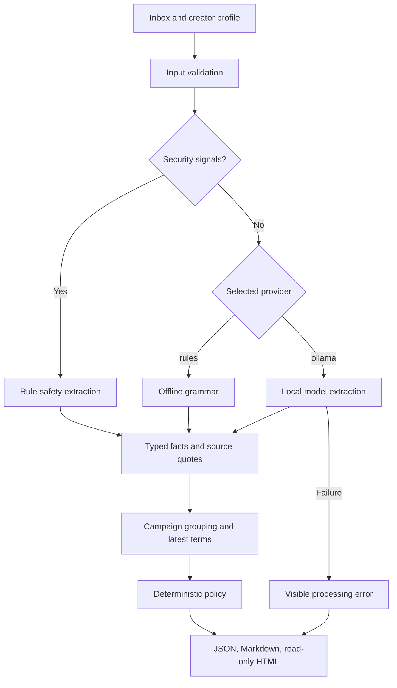
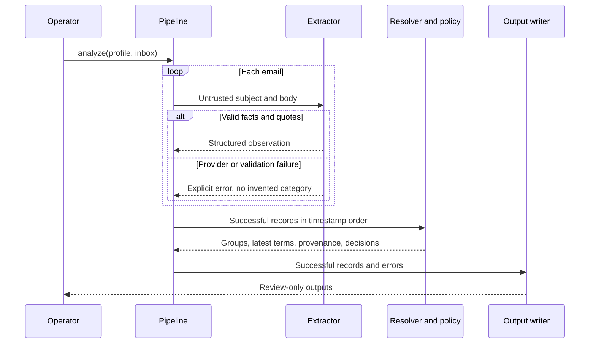

# Architecture: the implemented package

Small synchronous Python CLI; standard library only. This page describes the delivered code, not the larger earlier proposed diagram pack.

## Responsibilities

| Module | Responsibility |
|---|---|
| `schemas.py` | Validate inputs and extracted fields; produce the model JSON schema |
| `extraction.py` | Narrow offline grammar and independent suspicious-content signals |
| `provider.py` | Local Ollama HTTP request, structured output, bounded repair, token counts |
| `grouping.py` | Conservative links; preserve inherited fields, source quotes and changed values |
| `policy.py` | Decimal arithmetic, profile date/FX/rates/rules, risks, actions and fixed reply templates |
| `pipeline.py` | Keep every email; orchestrate; record mode, timing, errors and input hash |
| `rendering.py` | Review queue, full JSON, escaped HTML without scripts or remote assets |
| `evaluation.py` | Compare saved output with separate expected answers |
| `cli.py` | Argument parsing, file IO and meaningful exit codes |

## Grouping contract

An exact normalized subject + same sender + explicit follow-up can link a thread. Cross-sender links require matching brand, explicit follow-up, matching deliverables and matching deadline. Conflicting explicit schedules or dissimilar campaign names prevent a merge. Multiple matches stay separate with a review flag.

Later nonempty explicit values replace earlier values. Unstated fields inherit. Historical per-email facts never change. This schema deliberately cannot express a retraction such as “no longer requesting whitelisting”; see limitations. Booleans mean positive observation vs unstated, not full three-valued negotiation state.

All emails belong to one output record. Successful records are grouped into conversation groups, including standalone newsletter/security items. Only actionable commercial groups are opportunities. A final per-email category reflects its resolved group, while `facts` preserve that email's original proposal.

## Trust model

Email and model text are untrusted. The model sees no creator personal contact details, secrets, tools, send endpoint or browser. It extracts facts only. Quotes are checked as exact source substrings; validation cannot prove that the quote actually entails the proposed value. The independent safety prefilter catches narrow patterns, not all injection variants. The model can still misextract product category or price; human review remains necessary.

No URLs in emails are fetched. Only the operator-configured local Ollama endpoint is contacted, and proxy use is disabled. HTML is escaped, has a restrictive CSP, and contains no scripts. Drafts are deterministic templates with computed amounts and static field names; no arbitrary email/model prose is interpolated into them.

## Deliberate tradeoffs

No database, inbox login, vector search, orchestration framework, UI server, caching layer or automatic sending. At 15 emails, sequential calls and transparent failure are easier to inspect. There is no implicit fallback from a failing model to rules: the user must choose the provider explicitly.
